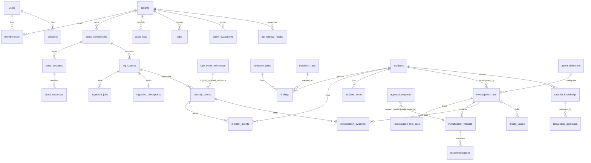

# Vigil — Database ERD

Source of truth: `packages/db/src/schema.ts` + migrations in `packages/db/migrations/`.
Every customer-owned table carries `tenant_id` and is protected by `FORCE ROW LEVEL SECURITY`.

## Key constraints & indexes

| Table | Constraint / index | Purpose |
|---|---|---|
| security_events | `UNIQUE (tenant_id, deduplication_key)` | idempotent ingestion, duplicate delivery |
| security_events | `(tenant_id, event_timestamp)`, `(tenant_id, source_ip, ts)`, `(tenant_id, principal, ts)`, `(tenant_id, trace_id)`, GIN `categories` | explorer, detection windows, agent pivots |
| raw_event_references | `UNIQUE (tenant_id, sha256)`; app role has no UPDATE/DELETE | immutable, content-addressed evidence |
| findings | `UNIQUE (tenant_id, dedup_key)` | alert dedup across re-runs (rule + group + window start) |
| incidents | `UNIQUE (tenant_id, case_number)`; `vigil_next_case_number()` advisory-locked | race-free CASE-NNNN |
| detection_rules | `UNIQUE (tenant_id, rule_id, version)` | versioned rules |
| agent_definitions | `UNIQUE (tenant_id, role, version)` | versioned agent configs |
| investigation_tool_calls | `UNIQUE (run_id, seq)` | ordered, complete tool trace |
| ingestion_checkpoints | `UNIQUE (tenant_id, log_source_id)` | one watermark/page token per source |
| jobs | `UNIQUE (tenant_id, idempotency_key)` | at-most-once enqueue per key |
| audit_logs | INSERT/SELECT only for app role; `prev_hash → hash` chain | tamper evidence |
| api_latency_rollups | `PRIMARY KEY (tenant_id, bucket, method, route)`; RLS | per-minute API latency histogram per route template (Operations page). Additive upsert; no per-request rows, IPs, paths or query strings; pruned after 7 days |
| worker_heartbeats | `PRIMARY KEY (worker_id)`; system table, no tenant data | worker liveness (random id per process, no hostnames); rows idle > 1 day are pruned |
| jobs | `(tenant_id, status, updated_at)`; `updated_at` set on claim/complete/fail | Operations queue depth and failure windows |
| ingestion_jobs | `(tenant_id, log_source_id, created_at DESC)` | last success / last error per log source |
| investigation_runs, model_usage | `(tenant_id, created_at)`, `(tenant_id, run_id)` | windowed failure and cost-per-investigation queries |

## Roles

| Role | Rights |
|---|---|
| `vigil_owner` | table owner, migrations, `BYPASSRLS` only for `SECURITY DEFINER` system functions (`vigil_due_log_sources`, `vigil_create_tenant`) |
| `vigil_app` | runtime role, `NOBYPASSRLS`, DML only where granted; every query runs under `app.tenant_id` |
