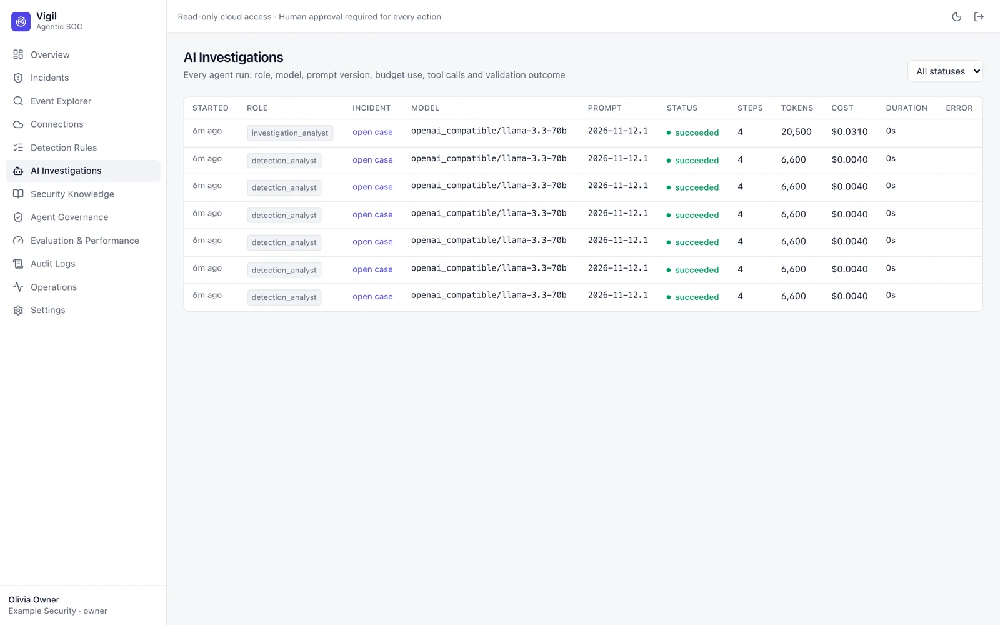

# AI Investigations

Every agent run across all incidents: role, model, status, steps, tokens, cost and duration.

Two agents work each case:

1. **Detection Analyst** triages a new incident with a small tool set and decides whether a full investigation is
   warranted.
2. **Investigation Analyst** gathers evidence through the tool broker and returns a structured verdict.

Agents never hold database or cloud credentials; they reach data only through allowlisted broker tools, see masked
identifiers by default, and every claim must cite events they actually retrieved. Output that cites events the agent
never saw, or invents IPs, is **rejected** and shown as such. Every verdict waits for a human review in
[[Incidents]].
