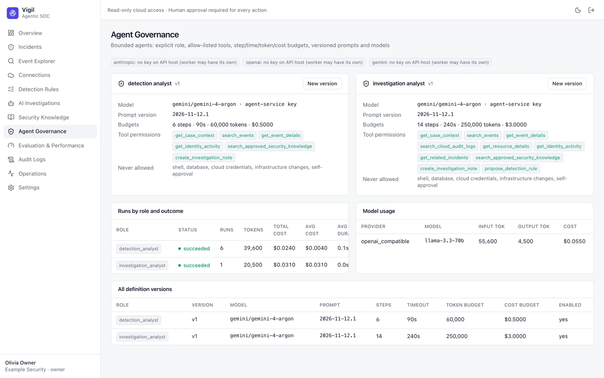

# Agent Governance

Each agent role has versioned definitions: model provider and model, allowed tools (a subset of the role's catalog),
maximum steps, timeout, token and cost budgets. Creating a new version never changes past runs. The page also shows
per-role run statistics, failure rates and model usage and cost.

Only admins and owners can change agent definitions. Model providers are configured in [[Settings]] → AI models.
