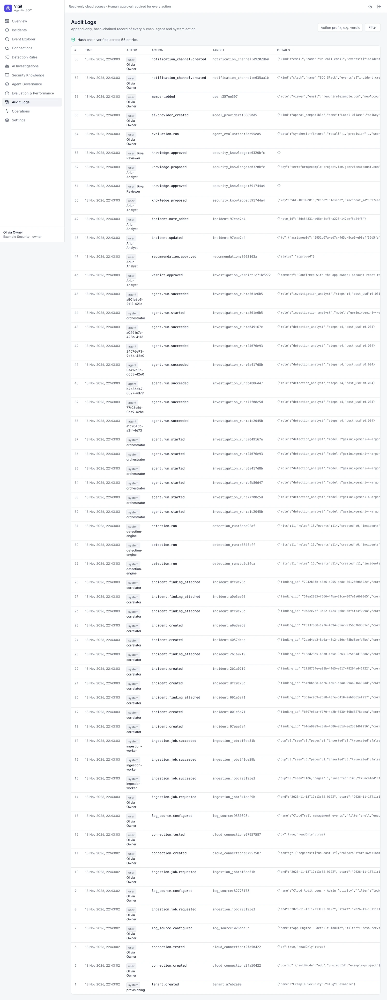

# Audit Logs

Every change — by people, agents and the system — is written to a per-organization, append-only audit log. Each entry
is hash-chained to the previous one, so deletion or modification is detectable; **Verify** recomputes the chain.

Secrets (API keys, webhook URLs, passwords) are never written to the audit log. Admins and owners can read it.
