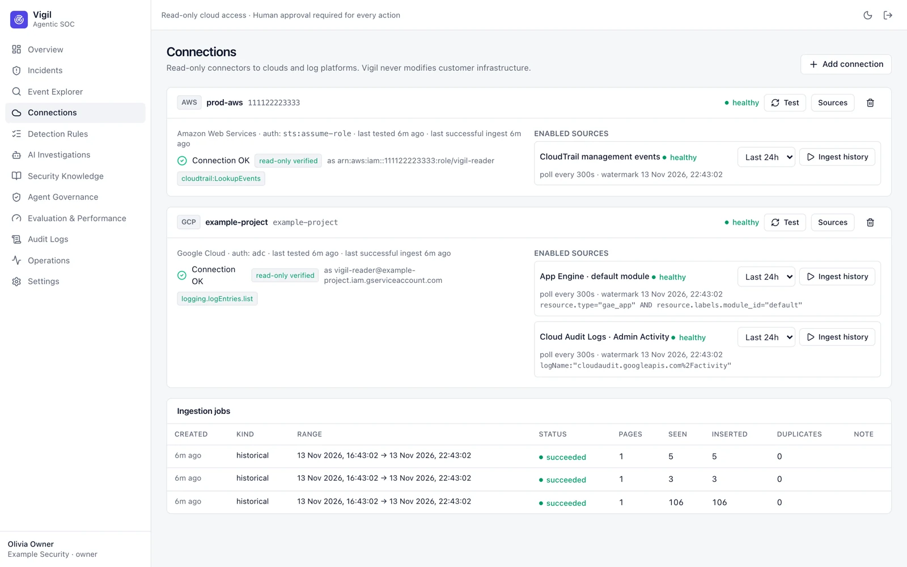
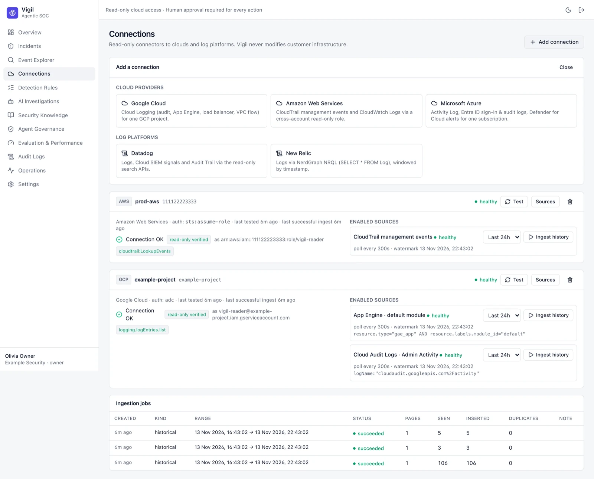

# Connections

A connection gives Vigil **read-only** access to one cloud account or log platform. Each connection has log sources
(for example App Engine request logs, Cloud Audit Logs, CloudTrail management events); ingestion runs per source,
incrementally, with checkpoints.

**Add connection** shows the supported connectors. The onboarding form for each is generated from the connector's
schema and explains exactly which read-only role to grant. Prefer keyless authentication (workload identity
federation, instance roles, managed identity); service-account keys are refused where the cloud supports better.

After saving, **Test** checks access and flags over-privileged credentials, then Vigil discovers available log sources
you can enable and backfill for a time range.

Per-provider setup: [Self-hosting guide → Connect your first source](https://github.com/OneLab-X/vigil/blob/main/docs/SELF_HOSTING.md#8-connect-your-first-source).
Only owners and admins can add or change connections.
