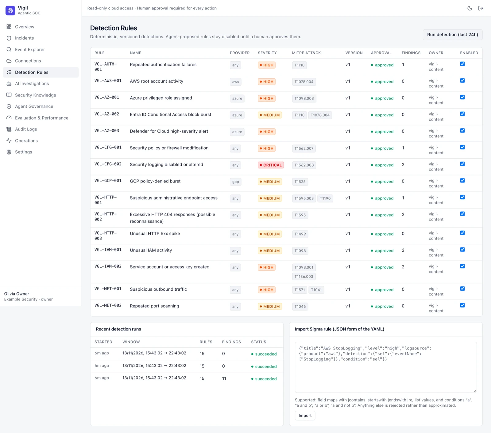

# Detection Rules

Detection is deterministic — no AI decides whether something is a finding. Each rule has an ID (e.g. `VGL-AUTH-001`),
provider scope (`any`, `gcp`, `aws`, `azure`), severity, MITRE ATT&CK techniques, version, approval status, finding
count, owner and an enabled switch. A built-in rule set (`vigil-content`) is installed for every organization.

- **Run detection (last 24h)** re-runs all enabled rules over recent events; **Recent detection runs** shows each run's
  window, rule count, findings and status.
- **Import Sigma rule** accepts the JSON form of a Sigma rule (field maps with `|contains`, `|startswith`,
  `|endswith`, `|re`, list values, and simple `and` / `or` / `and not` conditions). Anything else is rejected rather
  than approximated.
- Rules proposed by agents stay **disabled until a human approves them**.

Changing rules needs the admin or owner role. Check changes against the replay suite in [[Evaluation and Performance]].
