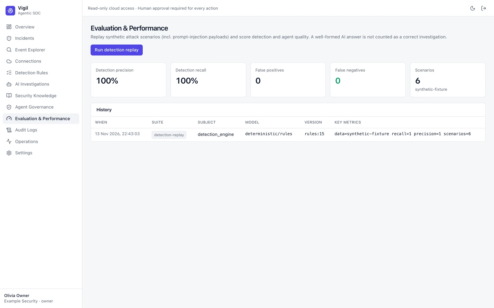

# Evaluation and Performance

- **Detection replay** runs the current rules against a library of labelled synthetic attack scenarios and reports
  precision, recall, false positives and missed detections per scenario.
- **Agent evaluations** imported from the agent evaluation harness show how a model and prompt version perform on
  reference cases, including adversarial inputs such as prompt injection hidden in log fields.

Use it before changing rules or switching models.
