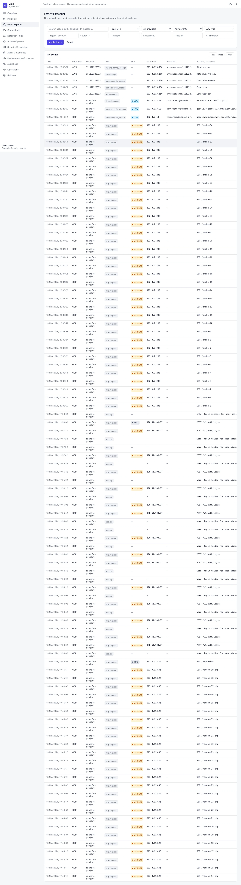
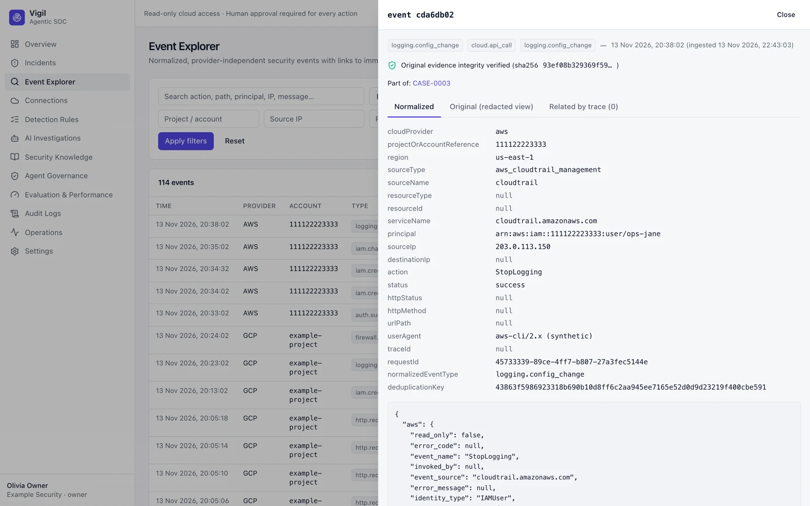

# Event Explorer

Search normalized security events across all sources by time range, provider, source IP, principal, action, status and
more. Results are paged, 100 at a time.

Click a row to open the event:

- **Normalized** — the common fields Vigil uses for detection.
- **Original (redacted view)** — the raw provider record with tokens, keys and passwords redacted. Raw evidence is
  stored write-once and its hash is re-checked when read (*verified*).
- **Related by trace** — other events sharing the same request trace (for example an App Engine request and the
  application log lines it produced).
