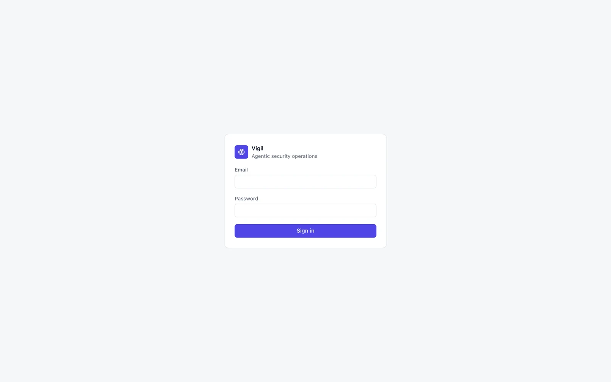

# Getting Started

## Install

On a fresh Linux VM with Docker, the installer sets everything up and creates the first owner. The complete guide —
requirements, HTTPS, cloud-specific notes, backup, upgrades — is the [Self-hosting guide](https://github.com/OneLab-X/vigil/blob/main/docs/SELF_HOSTING.md).

## Sign in



Sign in with the owner email and the one-time password the installer printed. You must choose a new password before
anything else works.

## First steps

1. **Add colleagues** — [[Settings]] → Members. New accounts get a one-time password shown once.
2. **Connect a source** — [[Connections]] → Add connection. Vigil only needs read access.
3. **Set up alerts** — [[Settings]] → Notifications (Slack and/or email), owners and admins only.
4. **Configure an AI model** (optional) — [[Settings]] → AI models. Without one, Vigil runs deterministic detection
   only and no data is sent to a model.

## Try it locally with demo data

```bash
pnpm install
pnpm db:start && pnpm db:migrate
pnpm db:demo     # fills an EMPTY database with synthetic incidents; refuses otherwise
```

See [[Maintaining this Wiki]] for running the demo stack next to your normal dev database.
