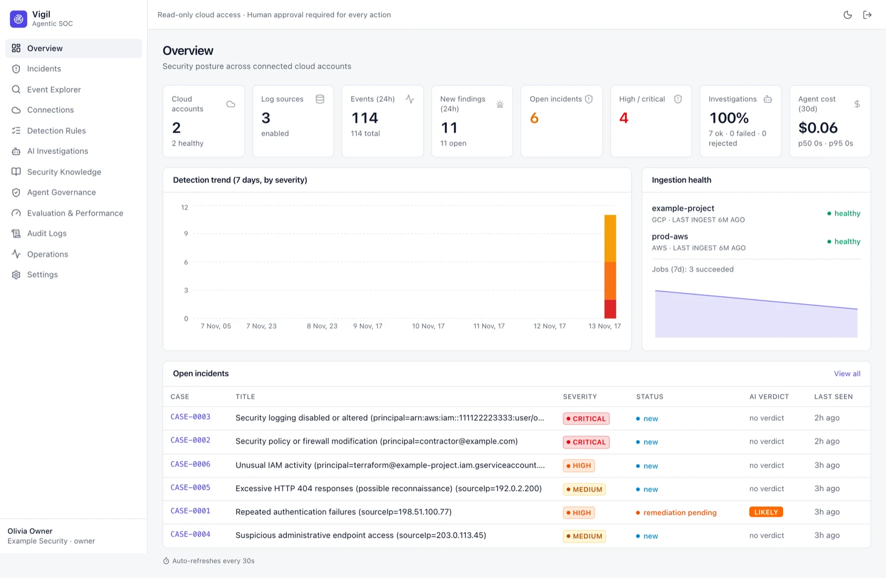

# Vigil documentation

**Vigil** is an open-source, self-hosted, AI-assisted security operations platform for your clouds. It reads cloud and
log-platform audit data with read-only, keyless credentials, detects suspicious activity with deterministic rules, has AI
agents investigate each incident with evidence they can only reach through a governed tool broker, and leaves the final
decision to a human.



```
Cloud signals → ingestion → normalization → deterministic detection → correlation
→ AI investigation → evidence-backed verdict → human decision → organizational learning
```

## Start here

| I want to… | Read |
|---|---|
| Install Vigil on a server | [[Getting Started]] and the full [Self-hosting guide](https://github.com/OneLab-X/vigil/blob/main/docs/SELF_HOSTING.md) |
| Understand who can do what | [[Roles and Permissions]] |
| Connect GCP, AWS, Azure, Datadog or New Relic | [[Connections]] |
| Work an incident end to end | [[Incidents]] → [[AI Investigations]] → [[Security Knowledge]] |
| Get alerts in Slack or email | [[Settings]] → Notifications |
| Understand the design and security model | [Architecture](https://github.com/OneLab-X/vigil/blob/main/docs/ARCHITECTURE.md), [Threat model](https://github.com/OneLab-X/vigil/blob/main/docs/THREAT_MODEL.md), [AI data handling](https://github.com/OneLab-X/vigil/blob/main/docs/AI_DATA_HANDLING.md) |

## Screens

| Screen | What it is for |
|---|---|
| [[Overview Dashboard]] | Posture at a glance: sources, events, findings, open incidents, agent cost |
| [[Incidents]] | Case list and the incident workspace: verdict, evidence, timeline, actions, notes |
| [[Event Explorer]] | Search normalized events and open the original record |
| [[Connections]] | Read-only cloud and log-platform connections, log sources and ingestion |
| [[Detection Rules]] | Deterministic rules, MITRE mapping, versions, replay |
| [[AI Investigations]] | Every agent run, its status, cost and outcome |
| [[Security Knowledge]] | Human-approved facts agents may use (trusted identities, known false positives, lessons) |
| [[Agent Governance]] | Agent definitions, models, tool allowlists and budgets |
| [[Evaluation and Performance]] | Detection replay and agent evaluation results |
| [[Audit Logs]] | Hash-chained, append-only record of every change |
| [[Operations]] | Workers, queues, ingestion lag and API latency |
| [[Settings]] | General, AI models, Members, Notifications |

> All screenshots in this wiki use **synthetic demo data** (`pnpm db:demo`): documentation IP ranges, the
> `example-project` GCP project, AWS account `111122223333` and `@example.com` people. See [[Maintaining this Wiki]].
