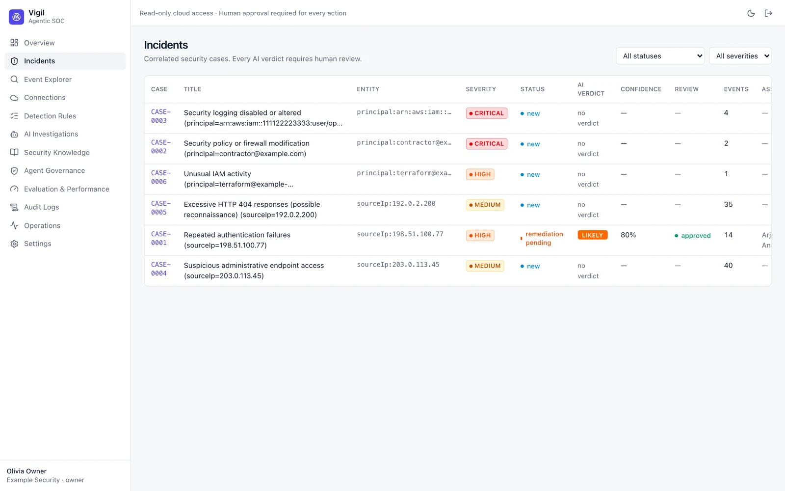
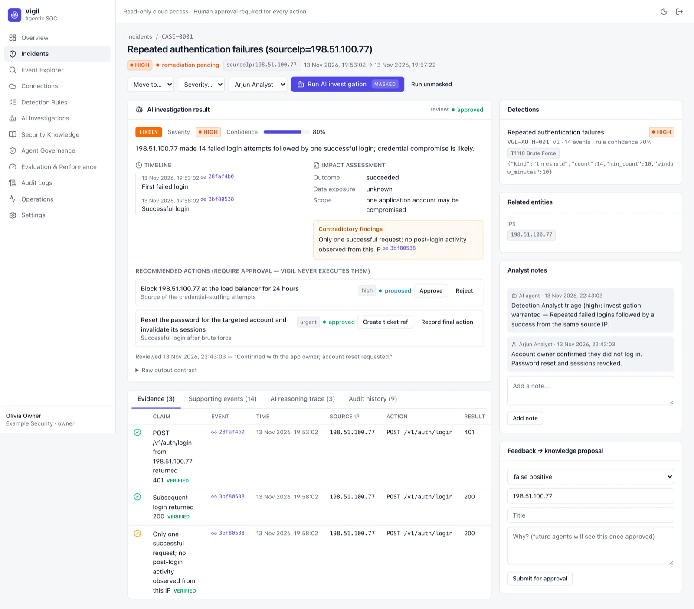
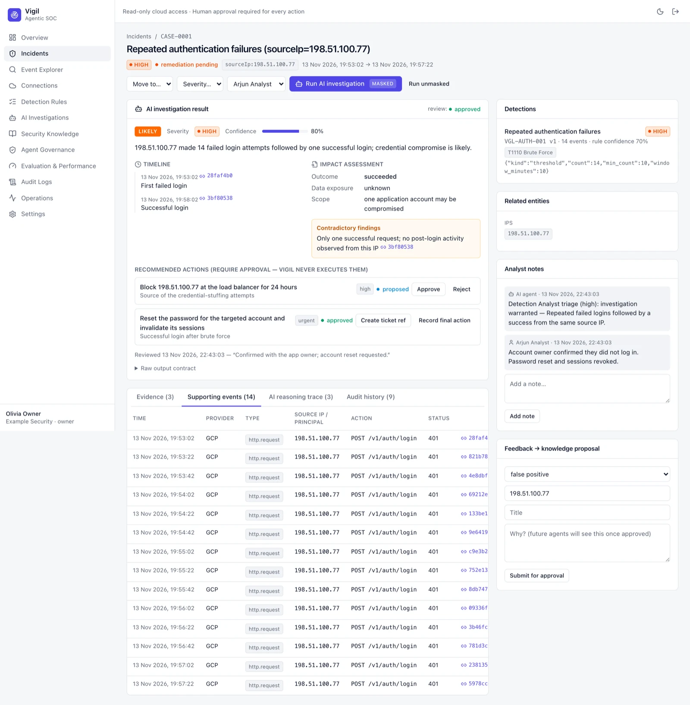
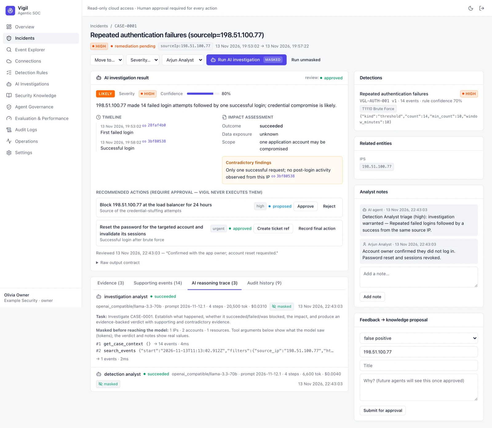
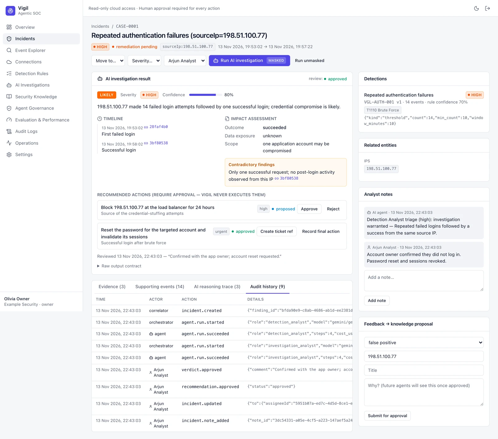
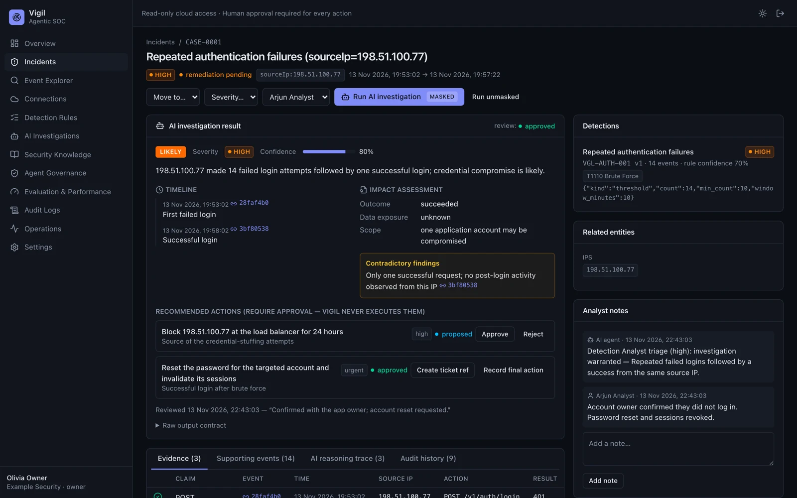

# Incidents

Detections are correlated into incidents (cases) by entity — for example a source IP or a cloud principal — so
repeated findings attach to one open case instead of creating new ones.

## Incident list

Filter by status and severity; open a case to work it.

## Incident workspace

Top bar: severity, status, primary entity and time span, plus actions — move to a new status, change severity, assign,
and **Run AI investigation** (masked by default; *Run unmasked* needs admin and is audited).

- **AI investigation result** — verdict, severity and confidence, a summary, a timeline whose entries link to the
  original events, impact assessment, and **contradictory findings** the agent had to report.
- **Recommended actions** — proposed by the agent, approved or rejected by a human. Vigil never executes them;
  record the ticket reference and the final action taken.
- **Detections** — the rules that fired, with MITRE technique and rule version.
- **Related entities**, **Analyst notes**, and **Feedback → knowledge proposal** (see [[Security Knowledge]]).

The lower panel has four tabs:

| Tab | Shows |
|---|---|
| Evidence | Every claim in the verdict with the event it cites; each is checked against stored evidence (*verified*) |
| Supporting events | The events correlated into this case |
| AI reasoning trace | Every tool call the agents made, with arguments and results |
| Audit history | Every change to the case, by whom and when |

