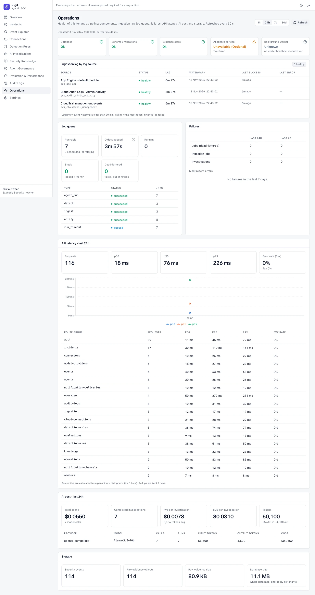

# Operations

Health of this organization's pipeline, refreshed every 30 seconds, over 1h / 24h / 7d / 30d:

- **Components** — database, schema migrations, evidence store, AI agents service and background worker.
- **Ingestion lag by log source** — status, lag, watermark, last success and last error. *Lagging* means the event
  watermark is older than 30 minutes; *failing* means the most recent job failed.
- **Job queue** — runnable, oldest queued, running, stuck and dead-lettered jobs, by type.
- **Failures** — dead-lettered jobs, failed ingestion jobs and investigations in the last 24 hours and 7 days, with the
  most recent (sanitized) errors.
- **API latency** — requests, p50 / p95 / p99 and error rates, overall and per route group.
- **AI cost** — spend, calls, tokens and cost per investigation, by provider and model.
- **Storage** — events, raw evidence objects and sizes, database size.

> In this screenshot the demo stack runs without the agent service and background worker, so those two components show
> *Unavailable* / *Unknown*. On a normal install both are green.

Command-line operations (status, logs, diagnostics, backup, restore, upgrade) are in the
[Self-hosting guide → Operations](https://github.com/OneLab-X/vigil/blob/main/docs/SELF_HOSTING.md#9-operations).
