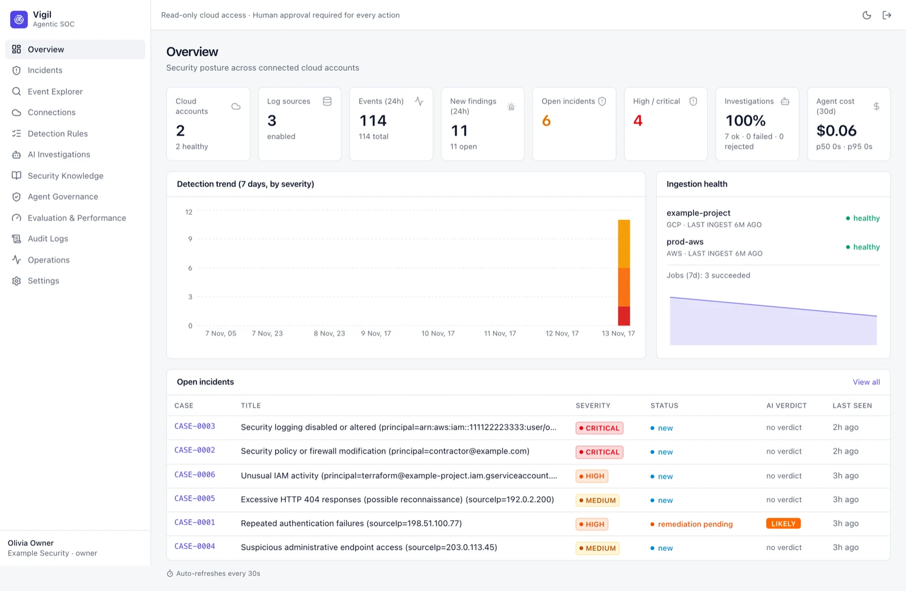
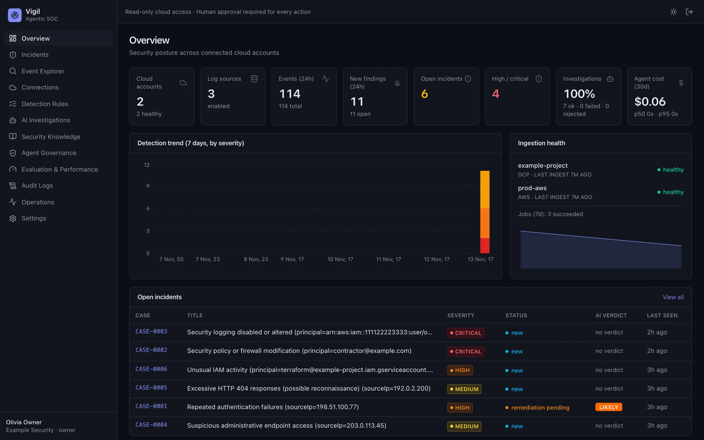

# Overview Dashboard

The landing page after sign-in. It refreshes every 30 seconds.

- **Tiles** — connected cloud accounts, enabled log sources, events and new findings in the last 24 hours, open and
  high/critical incidents, investigation success rate and agent cost over 30 days.
- **Detection trend** — findings per day for the last 7 days, stacked by severity.
- **Ingestion health** — each connection's status and last successful ingest, plus recent ingestion jobs.
- **Open incidents** — newest first, with severity, status and the AI verdict if there is one. Click a case to open
  it in [[Incidents]].

Dark mode is one click away (moon icon, top right):

