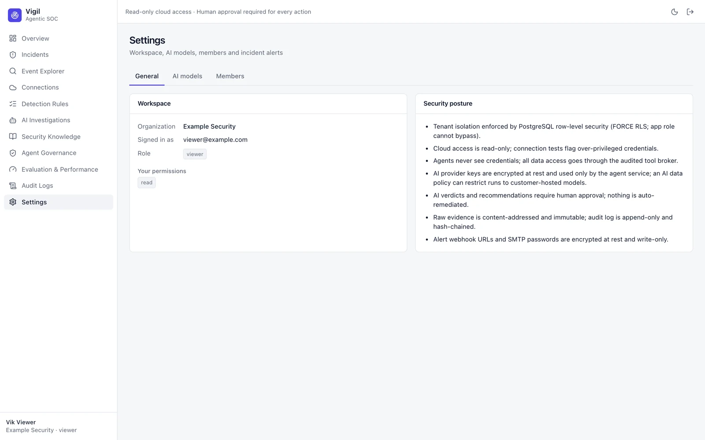

# Roles and Permissions

Every person belongs to an organization with one role. Roles are checked on every request, so a change applies
immediately.

| Role | Can |
|---|---|
| **viewer** | Read everything in the organization |
| **analyst** | + triage incidents, run investigations, review verdicts, propose and approve knowledge |
| **admin** | + detection rules, cloud connections, ingestion, agent settings, incident alerts, audit log, operations |
| **owner** | + manage members |

Some rules apply to everyone:

- AI verdicts and recommended actions need a human decision. Vigil never executes remediation.
- Knowledge proposed by one person must be approved by a different person.
- An organization always keeps at least one owner; owners cannot demote or remove themselves.

A viewer's Settings page shows only what they may see — for example, no Notifications tab:

