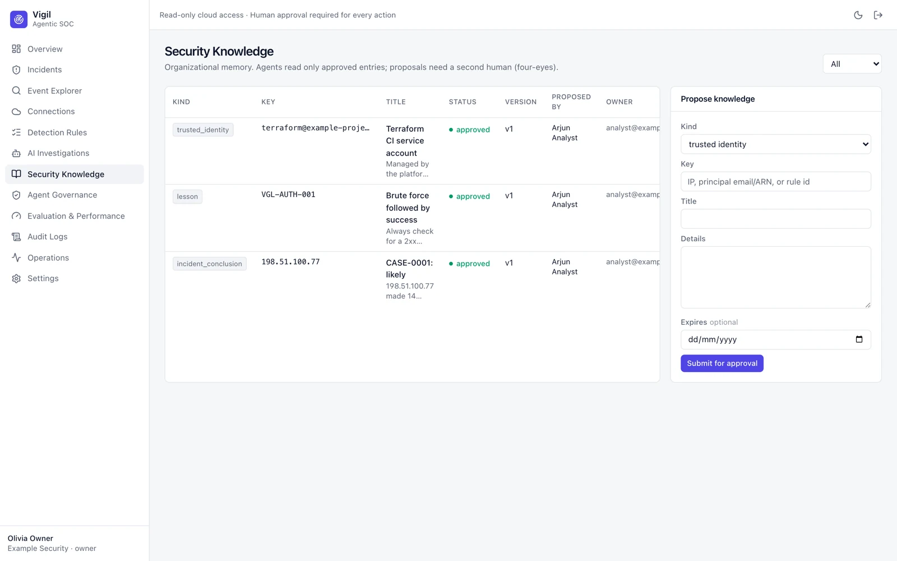

# Security Knowledge

Organizational memory that agents can search during investigations — but only once a human has approved it:

- **Trusted identities** — e.g. a CI service account that legitimately creates keys.
- **Known false positives** — expected patterns such as uptime probes.
- **Lessons** and **incident conclusions** — from analyst feedback on closed cases.

Anyone with analyst rights can propose an entry (also from the *Feedback → knowledge proposal* box on an incident); a
**different** person must approve it. Rejected and expired entries stay visible for audit.
