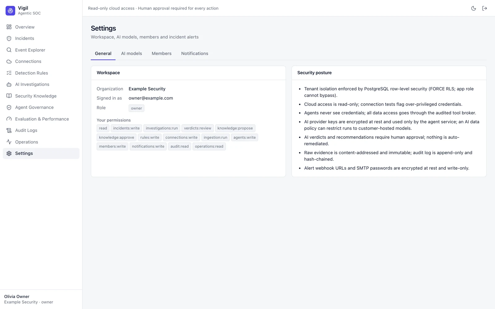
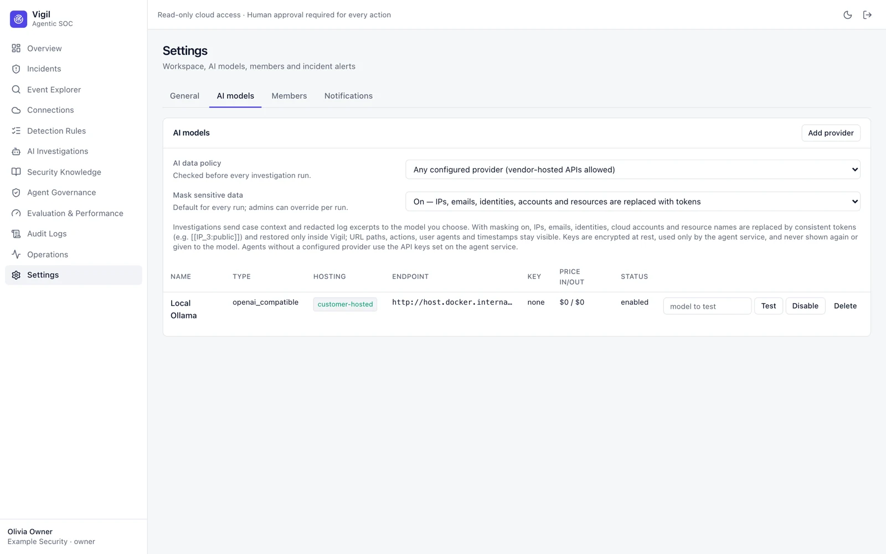
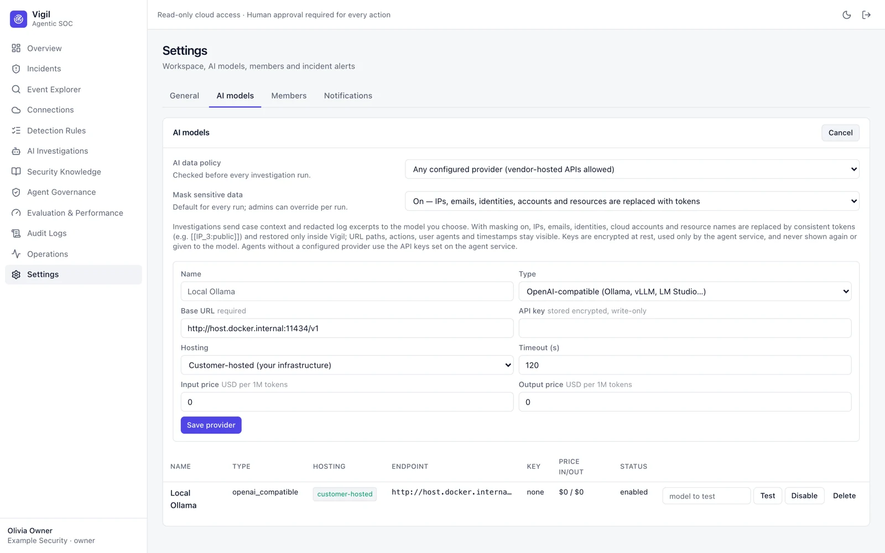
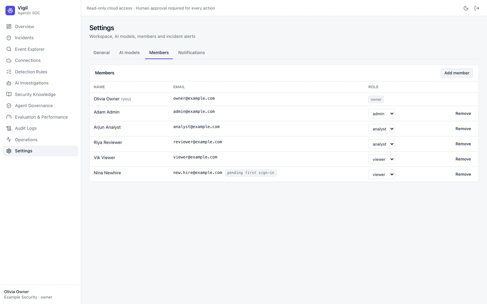
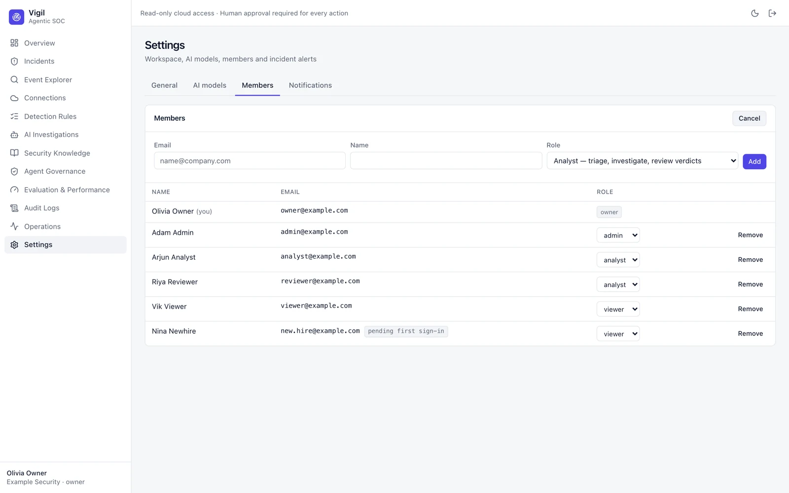
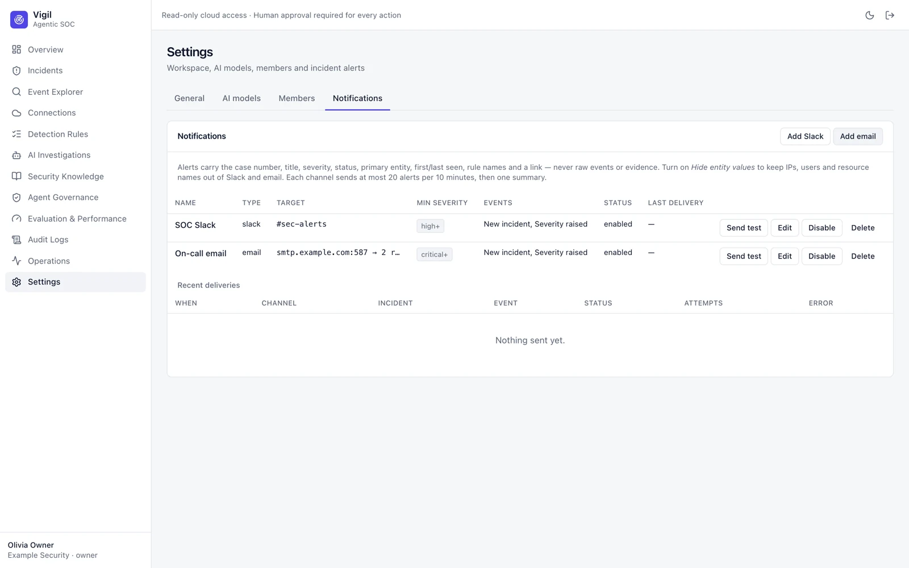
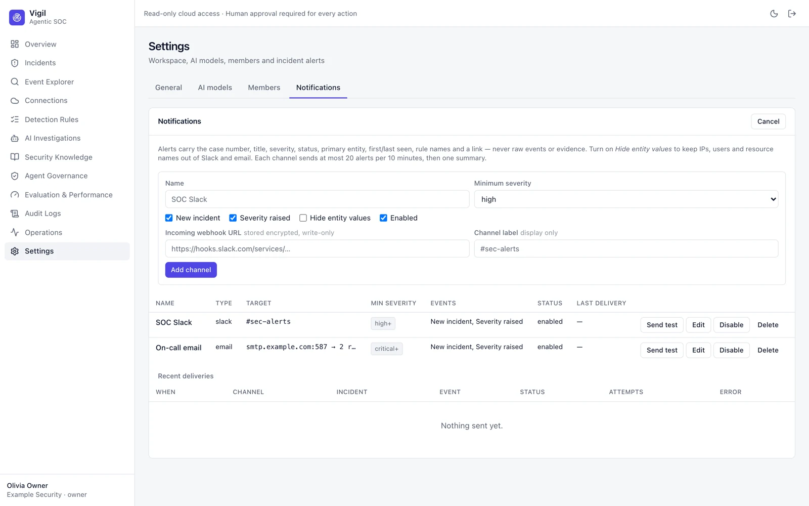
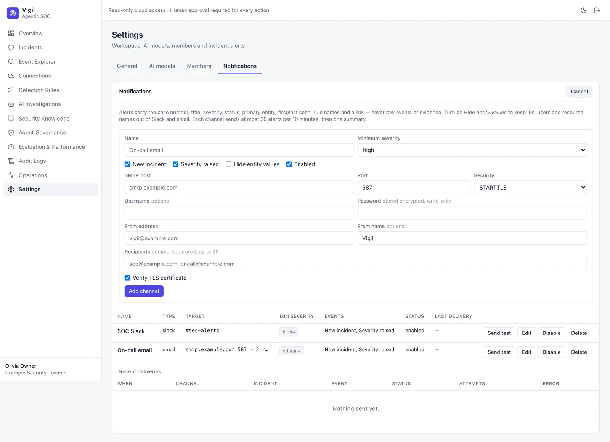

# Settings

Settings has four tabs. The selected tab is part of the URL (`/settings#members`), so you can link to it.

## General

Your organization, account and role, an organization switcher if you belong to several, your permissions, and a
summary of the platform's security posture.

## AI models

- **AI data policy** — allow any provider, only customer-hosted models (evidence never leaves your infrastructure), or
  disable AI investigations.
- **Mask sensitive data** — default on: IPs, emails, identities, accounts and resource names are replaced with
  consistent tokens before anything reaches a model.
- **Providers** — OpenAI-compatible endpoints (Ollama, vLLM, LM Studio…), Gemini, Anthropic or OpenAI. Keys are
  encrypted and write-only. **Test** checks a model before you use it.

## Members

Owners add people, change roles and remove members. Vigil does not send invitation emails: for a new account the
one-time password is shown **once** — share it privately; the person must change it at first sign-in (*pending first
sign-in*). Someone who already has a Vigil account keeps their password. See [[Roles and Permissions]].

## Notifications

Incident alerts to Slack and email — **owners and admins only**. Each channel has a minimum severity and alerts on
*New incident* and/or *Severity raised*.

| Slack | Email (SMTP) |
|---|---|
|  |  |

- **Slack**: paste an incoming-webhook URL (`https://hooks.slack.com/services/…`).
- **Email**: SMTP host, port, STARTTLS/TLS, optional username/password, from address and up to 20 recipients.
- **Send test** checks a channel; **Recent deliveries** shows what was sent, failed or held back.
- Alerts contain incident metadata and a link — never raw events. **Hide entity values** keeps IPs, users and resource
  names out of Slack and email.
- At most 20 alerts per channel per 10 minutes, then one summary.

Provider examples and network requirements: [Self-hosting guide → Incident alerts](https://github.com/OneLab-X/vigil/blob/main/docs/SELF_HOSTING.md#incident-alerts-slack-and-email).
